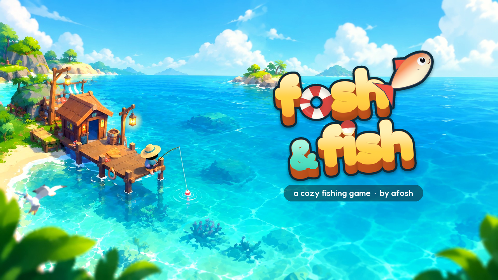

# Changelog

## Coming next

- **A new look for the Menu and the Shop.** A deep teal panel with a golden rim, a wooden sign for the title, big picture icons on the Menu, glossy buttons, and cream cards with bigger pictures and bolder names. The other panels follow.
- **A new picture on the enter screen, and a new icon.** The bay you start in is a new painting: the captain on his dock, a lantern, a rowboat and open turquoise water, with the same moving water, swaying leaves and leaping fish. The web version's loading page shows it too, and the game's icon is now a happy orange fish jumping beside a bobber.
- **Fish with friends, live.** Menu → Friends: make a party and send its 6-letter code to your friends. When they join, their boats sail in your bay with purple name tags, live, wherever they go, and you hear about their new catches and their waves. No account needed, and your party is still there the next time you play, until you leave it.
- **Other players in your bay.** People who played lately sail into your bay now and then, in their best boat, with their name and level over it. They fish for a while and sail off. Tap one and they call out something friendly, and you see who they are.
- **Share cards.** "Share it" on a shiny fish and "Share" on your Derby score make a picture to post anywhere: your biome, the shiny (or the gold Derby Cup), your name and the link to the game. On a phone the share menu opens; on a computer it's saved in Pictures/fosh&fish with the text copied.
- **The web version starts much faster.** The first visit downloads a third less (about 33 MB instead of 50), and a loading screen with the bay, the logo and a progress bar shows at once instead of a blank page.
- **A rebirth needs every charm maxed again, as on Discord.** With the treasure gear (Magnet and Artifact Magnet bait, the More Chests and Better Chests upgrades, a Treasure boost) a run's charms fill in about 5 to 6 hours, around when your level and money are there. The Charms and Prestige panels now say what finds more and better chests, with your own odds.
- **A fairer Derby board.** The server now checks every score against the best a run could really make, so nobody can post an impossible score.
- **Small fixes.** On small phones FishTok no longer squeezes the Calendar, Pets, Biomes and Spin panels off the screen. In a party, a friend's waves and catches show one line every few seconds instead of a flood, and resetting your save no longer leaves a ghost of your boat in your friends' bays.

## 1.0.0 — the Fishing Derby, one Shop, and charms you can fill (12 November 2026)

- **The Fishing Derby.** Menu → Derby: three minutes of Reel it in! rounds back to back, at the same difficulty for everyone (your rod, your level and the easing don't count). Every win scores points: more for rarer fish (they get rarer as the run goes on), for a perfect round and for a streak of wins. Play as often as you like: your best run of the week goes on the weekly board. When the week ends, the top three get the new **Derby Cup** hat (a gold trophy with the winning fish still stuck in it, head first) and Event Stars, the top ten get Stars, and everyone who played gets a few. It plays without an account too, and your best then stays on your device.
- **A Leaderboard of its own.** Menu → Leaderboard (or L): the top fishers, and this week's Derby board. No more digging through Account.
- **One Shop for everything.** Rods, Bait, Boats, Boosts, Fleet, Upgrades, Special, League, Hats and Pearls are tabs of the same Shop, so whatever you want to buy is where you open it.
- **A quieter Menu.** 12 big tiles instead of 22, without the descriptions, and a tile only speaks up when something's waiting ("7 to claim!"). Guide, Settings, Account, Radio and Updates are a small row at the bottom. The daily calendar and spin are tabs of Quests, the aquarium a tab of the Fish Book.
- **Charms are worth chasing.** Better chests drop charms more often, several of one kind at a time, and a won Reel it in! round finds a chest 2.5 times as often. Each kind goes up to tier 6 (one more tier every two prestiges), so with the treasure gear (Magnet baits, the More Chests and Better Chests upgrades) you can fill every charm in about 5 to 6 hours of a run, around when your rebirth is ready; on plain worms it takes about twice as long. Every charm you find shows a banner with its tier and how close the next one is, and Menu → Charms shows your total and the real rules. Charms still start over when you prestige, and prestige doesn't need them.
- **Chests say what they gave**, every one: the ones you buy (the Legendary chest from the Pearl Shop too), the ones your workers fish up and the ones in rewards. A chest never comes up empty once your charms are full.
- **A calmer phone screen**: icon-only buttons at the top right, a shorter catch card that fades sooner, the event countdown only in its last minute, and no locked-biome sign over the water.
- **Reel it in! goes easier on you after a bad streak.** Lose two rounds in a row and the next one has a slightly bigger net, a slower fish and a bit more time; lose more and it eases a little more; win and it's back to normal. Players who aren't losing won't notice anything, and the outlaw rounds keep their own easing. The Guide explains it.
- **The Baron's crown and the Duchess's tiara look like theirs.** The crown has swept-back wings now (the Baron is a flying fish) and keeps his waxed moustache, and the tiara swapped its bow for a glowing anglerfish lure with a little chandelier of crystals hanging from it.
- The public boards (the leaderboard, the shiny stock and feed, the Derby board) are read in a safer way on the server. Nothing changes for you.

## 1.0.1 — the Most Wanted, and FishTok beside the game (11 November 2026)

- **Seven different outlaws, not one fish.** The chase through the biomes is a hunt for seven fish, each with its own name, body, voice and tricks, and each caught for good. **Gerald**, the grumpy River pufferfish with the MUM tattoo, is only the first. Then **Sizzle**, a hot-headed lava catfish with whiskers on fire (Volcanic), **Captain Swordbeard**, a swordfish pirate in sailor's stripes (Ocean) and **Baron von Flap**, a flying fish in goggles (Sky), who hands over his crown. His fall brings a note from the Duchess, and the hunt goes on with **Commander Chomp**, a small and very confident space shark (Space), **Zlorp**, a three-eyed alien blobfish (Alien) and **The Duchess**, a huge anglerfish lady with pearls and a chandelier for a lure (Abyss), who gives you her tiara.
- Each one has their own intro, their own lines, a shadow that swims past your boat when they're near, and a round of gags: Sizzle sets the net smoking, the Captain duels with his nose, the Baron polishes his monocle, Zlorp beams your net up and the Duchess rings for her butler. Win a round and that outlaw is caught for good, with no more getting away. Lose and they laugh and leave you a tip, and come back a little easier. The second run's outlaws are a bit harder.
- The WANTED board has a different poster for each of them, with its own caption, and the aquarium shows every outlaw you catch.
- The crown is now the Baron's and the tiara the Duchess's. Hats, saves and progress carry over.
- **Fish while you scroll FishTok.** The phone now sits in a strip beside the game instead of covering it: the game makes room, so you can keep casting and reeling (the Reel it in! round runs next to the phone) and auto-fish keeps going. The Phone button (or P) puts the phone away and the game takes its room back. The little dock icon at the top of the phone (or D) switches to the old full-screen phone, and the game remembers your choice. In a window too narrow to leave the game room, the phone stays full screen.

## 1.0 — shiny fish, live events and the Google Play version (5 November 2026)

- **Shiny fish.** Every species has a rare, sparkling shiny, and only **3,000 of each exist in the whole world**, numbered (No. 0001 to 3000). Each shiny species you own adds +2% to your sell price. The server hands them out so it stays fair: at most 3 of each species per player and 3 new ones a day, and the odds fall for every copy you own and as the stock runs out, so nobody can collect a whole stock. Shiny fish need a (free) account. See them in Fish Book → Shiny.
- **An event every 10 minutes of play** (idle time doesn't count), each with its own look on the water:
  - **Golden Hour**: every fish sells for double.
  - **Fish Frenzy**: casts recharge twice as fast and bring +50% fish.
  - **Treasure Tide**: triple treasure chance and better chests.
  - **Meteor Shower**: shiny fish turn up five times as often.
  - **Boss Fish**: wear down the Leviathan with 25 catches (a reel-in win counts double) for a legendary chest.
- **Event fish and Event Stars.** The Golden Koi, Frenzy Piranha, Treasure Crab, Meteor Fish and the Leviathan only bite during their event, pay well and give Event Stars, as does every catch during an event. Spend them in **Events → Event Shop**: the exclusive **Starfall Rod**, the Shiny Lure, Event Chests and Frenzy Boosts.
- **Supporter Packs and Pearls** (in the Google Play version): one-time packs from $1.49 to $19.99. Every pack unlocks the Supporter Rod, and each gives more: Pearls, bonuses that last forever (money, XP, workers, shiny chance), boosts, and the exclusive **Pearl Rod** (Fisher Pack) or **Legend Rod** (Legend Pack). Pearls buy boosts, chests, events, the Shiny Lure and the Pearl Rod in the **Pearl Shop**. What you buy comes with your cloud save, on every device. Random things bought with Pearls show their odds.
- **Free rewards** (Google Play version): watch a short ad, only when you choose to, for double money (10 minutes), a Fish Boost or 10 Pearls (up to 8 ads a day).
- **Idle play: the game keeps going when you don't.**
  - **Auto-fish** (from level 5): switch on **Auto** and your boat casts by itself. Tapping or holding is still faster, and the Reel it in! mini-game faster still.
  - **Your fleet** (from level 5, Menu → Fleet): hire crews, one boat at a time from the Rowboat to the Abyssal Surveyor. Each makes a fishing trip every 15 seconds with your rod, in your biome, and you see their boats around yours. Upgrades: Bigger Nets, Faster Crews, Bigger Cooler and Sea Legs. The fleet starts over when you prestige, like your boats.
  - **While you were away**: your crews keep fishing when the game is closed (35% of their catch, for up to 4 hours; upgrades raise both). Come back to a "Welcome back!" card with everything they caught; in the Google Play version an ad can double it.
  - **Daily rewards** (from level 3, the gift at the top right): the daily reward now has a **7-day calendar** with a bonus every day (bait, boosts, spins, an epic chest, Pearls, and a jackpot on day 7), and there's a **free spin of the wheel** every day (the odds are shown next to it).
  - **Reminders** (web version, Settings → Reminders): a browser notification when your crews fill the cooler or a daily reward is ready, only while the tab is in the background.
- **A rival: Gerald.** A grumpy fish with a moustache, an underbite and a MUM tattoo has decided you're his rival. From level 10 he bites instead of a fish, even in Relax (never on auto-fish), and fights you in a round of Reel it in! with gags of his own. Beat him and he pays a bounty, then snips your line and gets away to the next biome. Lose and he laughs, leaves you a tip and comes back a bit easier: losing costs nothing. Catch him at the end of his run for his crown, and a note in a bottle arrives: "You caught my son. - Geraldine". His mum (a perm, pearls and a bow) starts a harder run, with her tiara at the end. They dress up for every biome, from a fireproof helmet with oven gloves to a miner's lamp on her perm. Once you've met him, the **WANTED** pill shows where he is and opens the WANTED board, with a poster for every stage. The chase carries on through prestige.
- **Things to find when sailing.** 21 residents live in the seven biomes, three in each, away from the shop: an otter floating on its back, a capybara in a hot spring, a little fish with a fake shark fin on a stick, a cloud sheep, an astro cat, a UFO beaming up a fish, a sunken TV that's still on, and more. One turns up at a time, somewhere your boat can reach. Sail close and tap it (from too far off it says "Too far. Sail closer!"): the first time pays well, and every one comes with a joke. The third in each biome is rarer. They all go in the new **Finds** tab of the Fish Book, with a shadow for each one you haven't found yet.
- **Collecting pays off.**
  - **34 achievements** (Menu → Achievements), half of them jokes: honk 100 times, get mugged by a gull, lose to Gerald 5 times, tap the aquarium 50 times. They pay Pearls, 258 in all, and the Menu shows a badge when one is ready to claim.
  - **Finish a page of the Fish Book** (every fish of a biome) and it gets a stamp and +5% money in that biome, for good.
  - **The aquarium** (Menu → Aquarium): every species you've caught swims in it, seen from the side, faces and all. Tap one for its name, how many you've caught and a fact about it. Visitors pay: your crews bring back up to 30% more while you're away (the more species, the more), and the "Welcome back!" card shows it.
- **Hats for the captain.** Eleven of them, in Shop → Hats: his straw hat, a pirate hat, a chef's hat, a propeller cap, a Viking helmet, a traffic cone, a top hat and a sombrero, plus a duck hat for finding 25 rubber ducks, and Gerald's crown and Geraldine's tiara for catching them. He wears it everywhere, fishing or sailing. Hats are just for laughs: they change nothing, and none of them costs Pearls.
- **Rebirths (prestige) come much sooner.** The first now needs level 60 and $5M, about 5 hours of play instead of days, and two starter goals lead you there. Each one after it takes about 6 hours, a little longer every time, and no rebirth needs charms any more.
- **The whole game is 10% easier**: +10% money and +10% XP.
- **A real soundtrack.** 90 minutes of music by the film composer Scott Buckley, warm piano, strings and folk, different in every biome and calmer at night. The water sound is gone. The **Radio** (Menu → Radio, or tap what's playing) lets you pick any track, and **Just listen** fades the menus away while the game plays by itself to the music.
- **The catch is the best moment now.** The float nibbles and goes under, the rod bends, the line goes tight and hums, then the fish bursts out of the water with a splash and flies to the boat, flopping on the deck at the captain's feet, with the rest of a big catch flying in behind it. The biome's best fish put up a fight first. A new species or an event fish hangs in the air with its name on it, and the whole picture shakes.
- **The world moves.** The trees sway in the wind. Everything mirrors in the water: the shop, the dock, the shore and your boat. A day passes every 13 minutes of play: a golden sunset on the water, then night with lit windows, lamps shining on the water, a lantern on your boat, stars in the water and fireflies on the shore, and the music changes with it. In the Volcanic biome the land goes dark and the lava glows. **Settings → Scenery effects** turns all this off if a device struggles.
- **A new logo, on the painted bay.** Golden letters with a life ring for the "o", in the game's own 3D look, and a new app icon. The title screen is still the hand-painted bay with its deep-sea panel, now with the new logo, a gold Play button and, now and then, a real fish leaping out of the turquoise water with a splash. The loading screen is the painting too.
- **Easier on the eye.** A warm paper and sea-glass look instead of cold white, one line of text instead of two, no keyboard chips on the screen (they're in the tooltips), softer water sparkle, and the interface around the edges fades back when you're not using it.
- **Poke everything.** Crabs somersault, gulls squawk, tap your boat to honk, the captain mutters to himself. Bottles float by with notes in them, rubber ducks too (nobody knows why you're collecting them). And if a gull flies off with your lunch, tap it before it's gone.
- **Boats really turn now.** Every boat exists from every side, with foam and a reflection for each angle: it swings round through the bow instead of flipping like a sheet of paper, and it sails where its bow points, so an about-turn is a proper arc. Big ships swing slower than little boats.
- **Reel it in! pays +200% fish and got a sense of humour.** The fish on your line is the actual species you hooked, with a face and a name, and it fights dirty: fake moustaches, selfies for FishTok, playing dead, banana peels on your net, rockets, old boots, bribes, and a shark passing by that makes it beg to be caught. Puffers puff and fly off like a balloon, squid ink the water, turtles close for business. You end with its mugshot, or a WANTED poster.
- **New players start with Reel it in!** The first three rounds are easier (the very first is almost impossible to lose) and a line on screen shows how to play. After the third round, one question: keep reeling for +200% fish, or just relax. The first minute is calmer too: one tip at a time, and a tap on the water always casts. Already playing? You stay in the mode you had.
- **Phones vibrate**, softly: a bite, the reel, a catch, a rare fish, a shiny, Gerald, the honk and a poke each have their own little buzz. Auto-fish stays quiet. Turn it off in Settings → Vibration. (Browsers on iPhone can't vibrate.)
- **New creatures, seen from the game's own camera.** All the fish now swim as what you actually catch, with tails that wag, turtles that paddle and squid that trail their tentacles, instead of flat shapes from above. Pufferfish are plump little fish that row with their side fins, not spiky balls (until you catch one). Fish steer clear of the shore, the dock and the rowboat. New gulls flap and glide, and rest on the dock. New crabs walk sideways on the sand and wave their claws. Now and then a fish jumps out on the water by itself, dolphins most of all.
- **A new look for the whole game.**
  - **A real view of the world**: the camera now looks across the water at an angle, so buildings show their walls, boats their hulls and trees their trunks, in every biome.
  - **A new fish shop**: a timbered house on a wooden deck by the shore, with a stall of fish on ice, lanterns, a golden fish on the roof, smoke from the chimney and a shopkeeper who waves. It's built into each biome in its own colours and stands clear of the buttons. Tap anywhere on it to shop.
  - **A new captain**: he sits on the deck with his legs out and really fishes, gets up to cheer, waves, yawns and nods off under his hat. He sits in a spot that fits him on every one of the 17 boats, at the same size on all of them.
  - **New trees, bushes and rocks**, and richer colours: clearer water, hotter lava, soft clouds in the Sky biome and pink blossom on its trees.
  - **Living water**: foam laps around every hull, each boat has a shadow on the water, thin waves and sun sparkle move across the surface, and cloud shadows drift over everything.
  - The Alien Raft now looks like a saucer, with a canopy on it.
- **New art**, rendered in Blender like the rest: 20 shiny fish, the 5 event fish, the Starfall, Pearl and Legend rods, the Supporter Pack icons, the Pearl and the Event Star.
- **Livelier**: buttons squash when you press them, panels pop open, the catch card pops in, and when you sell, coins fly into your money as it counts up. Shinies ring a bell.
- The Supporter Rod now comes with Supporter Packs (if you already have it, you keep it). Exclusive rods stay with you through prestige.

## 0.5 — the full release (14 October 2026)

- **Everything from the 0.5 updates (0.5.1 to 0.5.14) in one download**, for Windows, Linux and Android at **https://foshfish.xyz**. New downloads start on the newest version straight away, no update needed.
- **The new look all the way through:** the leaping-fish app icon and the deep-sea loading screen are now in the Windows and Android apps too (an in-game update can't change those).
- Already playing 0.5.x? Menu → Updates (or the title screen) installs it in-game, and your game then shows **0.5**. The web version updates itself.

## 0.5.14 — in-game update

- **fosh&fish has a home: https://foshfish.xyz** (downloads for Windows, Linux and Android). The web version moved to **https://foshfish.xyz/play/**. The game now checks for updates there.

## 0.5.13 — in-game update

- Logo tidy-up: the splash line under "fish" is gone (it looked like an underline), and the logo on the title screen is smaller.

## 0.5.12 — in-game update

- The web version downloads about 5 MB less (store and social cover images aren't packed into the game any more).

## 0.5.11 — in-game update: a new look

- **Rebrand.** fosh&fish has a new logo: chunky white letters, a little leaping fish and a splash, in deep-sea teal and mint. There's a new app icon (a fish leaping out of the waves), a deep-sea loading screen, and new store / social covers. The title screen uses the new logo.
- The web version shows the new icon and loading screen right away. On Windows and Android the in-game logo changes now; the app icon and the first loading screen change with the next full download.

## 0.5.10 — in-game update

- **A new title screen design.** The picture is sharper (upscaled art) and the right side is now a deep-sea panel with a gently moving wave edge, drifting bubbles and fish shadows. It greets you ("Welcome back, afosh!"), puts a big **Play** first, and you can **sign in or create an account right there** (email and password fields open in the panel, no extra window). Updates show as one line, or a highlighted strip with a button when there's something new.

## 0.5.9 — in-game update

- Web: the title screen's update check no longer says "Can't reach the update server" when the game has just started (it now waits a moment, and retries once on its own).

## 0.5.8 — in-game update

- **A title screen.** The game now opens on a hand-painted dock at sunrise, with shimmering water, swaying leaves, bobber ripples, flickering lanterns and the odd passing gull. Everything you need before you play is in one card: **sign in or create an account** (or see that your cloud save is synced), **check and install updates**, then press **Play** (or Enter / Space) to dive in. Settings are one tap away too.

## 0.5.7 — in-game update

- **Phones: menus scroll with your finger.** Drag anywhere on a menu, even on a card or a button, and flick to keep it moving. Before, cards swallowed the drag and only the thin scrollbar worked. A drag never presses the button it started on; a tap still does.
- **Phones: a less giant interface** (about 10% smaller by default), and a new **Settings → Interface size** (Smaller / Normal / Bigger) on every device.
- **Phones: the Account form fills the screen** (the "Your fish, everywhere" column is hidden there), so signing in needs no scrolling.
- If a reset-password email can't be sent, the game now says so instead of "The server is having trouble".

## 0.5.6 — in-game update

- **Web: no more empty boxes.** Symbols like ✓, ✗, ★, arrows and a few emoji aren't in the game's font. Windows and Android quietly filled them in from system fonts, but browsers showed empty squares (in the catch card, goals, quests, prestige, updates and FishTok). They're now icons or plain text everywhere.

## 0.5.5 — in-game update

- **Two devices, one account:** if your phone saved while your PC was also playing, the PC's next cloud save used to replace it silently (coins and fish from the phone were lost). Now the game only replaces the cloud save it last saw; if another device saved in between it checks again and loads it, or asks you which one to keep.
- **No more random sign-outs with two tabs or windows open:** logins are single-use behind the scenes, so the second tab used to get signed out. Tabs and windows now share the newest login.
- A cloud save made by a newer version of the game is never replaced by an older copy; the older copy asks you to update instead.

## 0.5.4 — in-game update

Get it in the game: **Menu → Updates → Update now** (the web version updates on reload).

- **A phone-sized interface:** on phones everything was the PC layout shrunk to half size. Text and buttons are now about 1.6× bigger, menus fill the screen as scrollable sheets, small print has a minimum size and the Reel it in! card fits short screens. PCs and tablets look the same as before.
- **Web: cloud save fixed.** Signing in worked, but saving and loading your cloud save failed with "Can't reach the server" (the browser had already unpacked the server's compressed reply and the game tried to unpack it again). The in-game update check on the web had the same bug.
- **Web on phones:** holding the phone upright shows "Turn your phone sideways" instead of a tiny squashed game.
- Phones: the welcome card waits until you've made your first cast, and no longer mentions keyboard keys.

## 0.5.3 — in-game update

- **Reel it in! balanced:** 0.5.2 made it too easy. Now common fish are a fair challenge with the starter rod, rare fish really need a better rod, and even the best rod can lose to the rarest fish. Keyboard & mouse stays a little easier than phones.

## 0.5.2 — in-game update

Get it in the game: **Menu → Updates → Update now**.

- **Reel it in! is much easier**, and better rods help: every rod now has a **reel power** (0–10, shown in the Shop and in the mini-game). More power = a bigger catch zone, a faster reel and less slipping. With the best rods every fish is catchable.
- **Easier on PC and Linux:** with keyboard and mouse the zone is bigger, the fish calmer, the reel faster, you get 2 extra seconds and the zone is easier to control.
- Phones got fairer too (the starter rod now beats common fish most of the time).

## 0.5.1 — in-game update

Get it in the game: **Menu → Updates → Update now** (no new download).

- **Reel it in!** A new way to catch: switch the pill next to the cast button from *Relax* to *Reel it in!*, then keep the cheeky fish in the zone. Win for **+75% fish** and a **0.5 s cooldown**; lose and you still get your normal catch (the fish just blows a raspberry at you).
- **A new fisherman:** a chunky sea dog who sits on his cooler, yawns, sips his mug, dozes off, waves at seagulls, dances for new fish and facepalms when nothing bites.
- The line now reels back to the rod after every catch.

## 0.5 beta — the big update

Play in the browser: https://iiafosh.github.io/fosh-and-fish/ · Downloads: https://github.com/iiafosh/fosh-and-fish/releases/latest

**New**
- **Sailing:** steer your boat (WASD, or drag it) and sail off the map edge into the next biome. Locked biomes tell you the level you need.
- **FishTok:** a phone inside the game (P). A daily *trending fish* sells for +50%, a daily challenge, and your best catches get likes and followers with rewards.
- **Online accounts:** cloud save, play on any device, and a leaderboard (Menu → Account).
- **In-game updates:** from now on, new versions install from Menu → Updates; no new download needed.
- **17 new boats**, from a rowboat to a ghost ship and an alien saucer.

**Better**
- A new minimal look: small pills at the top, a round cast button, a Menu (Esc) and the Fish Book (Tab).
- The line lands **where you tap** (only on water), and you can **hold** to keep fishing.
- **Beginner's Luck:** extra XP early on, so chests and boosts (level 10) arrive in about 6 minutes instead of 15.

**Fixed**
- The game was broken on phones set to Arabic (the map slid off-screen); Arabic text now shows properly.
- A white ring sat on top of the boat.
- The boat no longer squashes paper-thin when it turns around.

## 0.1 beta — first public test

**Made by afosh** — [LinkedIn](https://www.linkedin.com/in/mostafa-kmal-3731453a9/) · [GitHub](https://github.com/iiafosh)

Play in the browser: https://iiafosh.github.io/fosh-and-fish/

**Game**
- Full Virtual Fisher (Discord bot) progression: 20 fish, 21 rods, 17 boats, 8 baits, 7 biomes (River → Abyss),
  the real 25,000-level XP table, per-rod catch odds and fish-quality rules from the wiki.
- Chests (Common → Artifact, Super), Gold / Emerald / Lava / Diamond fish, 8 charms, 5 pets.
- Shop, special and league upgrades; Fish / Treasure boosts and Workers; daily reward, daily quests,
  league quest and weekly Hooks.
- Prestige with Azure Fish and the prestige shop, including the community P1–P160 buy-order chart.

**Look & feel**
- Top-down Blender-rendered biomes with see-through water, shoreline foam and caustics.
- Animated fisher holding your equipped rod; boats change as you upgrade.
- Swimming fish, whales and manta rays, flapping seagulls, beach crabs.
- A Bait & Tackle fish shop on the island — tap it to shop.
- Tap / click anywhere on the water to cast (fixed: the scene used to swallow the click).
- Cozy parchment UI, "Next goal" hint, catch card, keyboard shortcuts, sounds and water ambience.

**Platforms**
- Windows, Linux and Android (APK) builds, plus a web build that works on any phone browser.

**New in this beta**
- In-game **Guide** (press **G**) covering every system.
- In-game **Feedback** form that opens a pre-filled GitHub issue.
- **Settings** (gear button or **O**): music and sound on/off + volume, fullscreen, reset save.
- Game icon, loading screen and cover art.
- Fishing cooldown now starts when you cast, not when the fish lands.
- **Better start:** step-by-step tutorial pointer, 10 starter goals with rewards, "New fish discovered!" banners and a fish collection (x/20), lucky bonus splashes and early treasure before level 10.

**Known limitations**
- Prestige requirements after P0, per-level upgrade prices and chest weights are estimates
  (the sources don't publish them) — balance feedback welcome.
- No cloud saves yet; desktop and web saves are separate.
- Android APK is a test (debug-signed) build; no iOS app yet — iPhone players use the web version.
