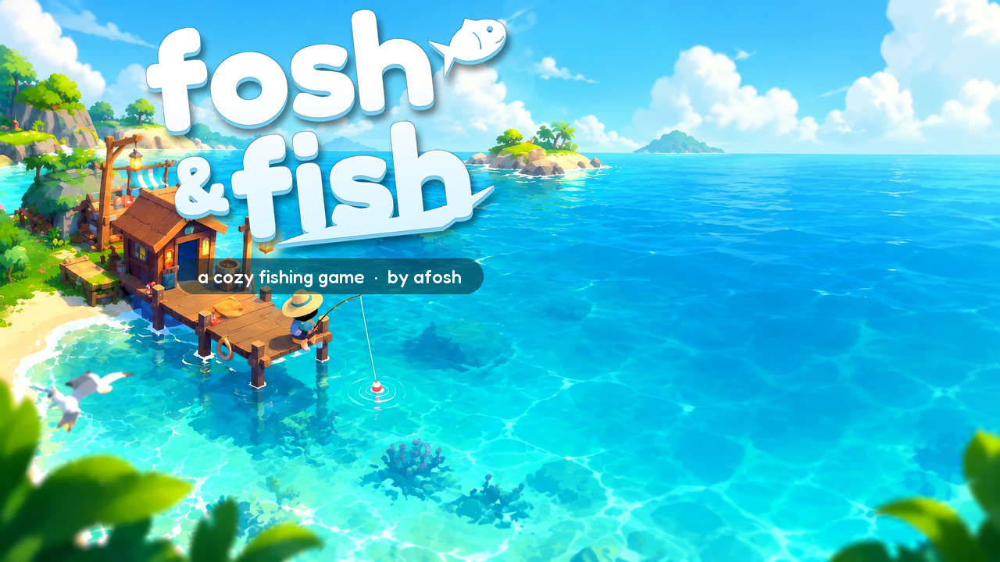

# 🐟 fosh&fish



A cozy top-down fishing game inspired by the **Virtual Fisher** Discord bot. Cast, catch, sell,
upgrade your rod and boat, travel through 7 biomes from the River to the Abyss, find pets and prestige.
Made with **Godot 4**; all the art is rendered in **Blender**.

**Made by afosh** · [LinkedIn](https://www.linkedin.com/in/mostafa-kmal-3731453a9/) · [GitHub](https://github.com/iiafosh)

## ▶️ Play (0.5 beta)

| Device | How |
|---|---|
| 🌐 **Browser** | Play instantly at **https://foshfish.xyz/play/** |
| 🖥️ **Windows** | [Releases](https://github.com/iiafosh/fosh-and-fish/releases/latest) → `fosh_fish-0.5-windows.zip` → extract → `fosh_fish.exe` |
| 📱 **Android** | [Releases](https://github.com/iiafosh/fosh-and-fish/releases/latest) → `fosh_fish-0.5-android.apk` → allow *Install unknown apps* |
| 🐧 **Linux** | [Releases](https://github.com/iiafosh/fosh-and-fish/releases/latest) → `fosh_fish-0.5-linux.tar.gz` → `./fosh_fish.x86_64` |

No Godot or other install needed. After installing once, new versions arrive inside the game: **Menu → Updates**. How to play: [GUIDE.md](GUIDE.md) or press **G** in the game.
What's new: [CHANGELOG.md](CHANGELOG.md).
🎬 Watch the 0.5 update video: [YouTube cut](https://github.com/iiafosh/fosh-and-fish/releases/download/v0.5/fosh-and-fish-0.5-yt-16x9.mp4) · [Shorts](https://github.com/iiafosh/fosh-and-fish/releases/download/v0.5/fosh-and-fish-0.5-yt-9x16.mp4) · trailer: [widescreen](https://github.com/iiafosh/fosh-and-fish/releases/download/v0.5/fosh-and-fish-0.5-trailer-16x9.mp4) · [square](https://github.com/iiafosh/fosh-and-fish/releases/download/v0.5/fosh-and-fish-0.5-trailer-1x1.mp4) · [vertical](https://github.com/iiafosh/fosh-and-fish/releases/download/v0.5/fosh-and-fish-0.5-trailer-9x16.mp4)

## 💬 Feedback

In the game: **G → Feedback**, or [open an issue](https://github.com/iiafosh/fosh-and-fish/issues/new/choose).
Bugs, balance, ideas and art notes are all welcome.

## 🎣 What's in it

- **20 fish, 21 rods, 17 boats, 8 baits, 7 biomes**, with the bot's prices, levels, cooldowns and catch odds
- **Chests**, **Gold / Emerald / Lava / Diamond** fish, **8 charms**, **5 pets**
- Shop, special and league **upgrades**, **boosts & workers**, daily reward, daily and weekly quests
- **Idle play**: auto-fish, a **fleet** of crews that fish for you (even while the game is closed, with a
  "Welcome back!" catch), a 7-day reward calendar and a daily spin
- **Prestige** with the Prestige Shop and the community P1–P160 buy-order guide
- A guided start: a pointer for the first steps, starter goals with rewards, and a fish collection
- Settings for music, sound and fullscreen; progress saves automatically

Mechanics follow the Virtual Fisher Encyclopaedia, the [miraheze wiki](https://virtualfisher.miraheze.org)
(snapshot in `wiki_dump/`) and the Prestige 0 Guide. Values the sources don't state are marked
`DERIVED` in `scripts/vf/vf_data.gd`.

## 🛠️ For developers

Open the folder in **Godot 4.7** (or run `launch_game.bat`).

```
scripts/vf/      vf_game.gd (simulation, autoload VF) · vf_main.gd (UI) · vf_stage.gd (scene) · vf_data.gd (data) · vf_guide.gd
                 vf_v1_ui.gd (1.0: Store, Events, shinies) · vf_idle_ui.gd (auto-fish, fleet, daily) · vf_notify.gd
scripts/         audio_manager.gd (music, sounds, settings)
scenes/          vf_main.tscn (main scene)
shaders/         water caustics
assets/vf/       sprites and scenes rendered by Blender
assets/brand/    logo, icons, covers, splash (made by tools/art/make_brand.py)
assets/third_party/   Kenney / Quaternius / OpenGameArt assets and the Fredoka font (see CREDITS.md)
data/vf/         XP-per-level table (25,000 levels)
tests/           headless mechanics and balance checks
tools/blender/   the Blender art pipeline
tools/           fetch_assets.py · serve_web.py · extract_doc.py · github/ · jev/ (design-decision helper)
wiki_dump/       source snapshot of the wiki and encyclopedia
```

**Tests and screenshots**
```bash
Godot_console.exe --headless --path . -s res://tests/vf_sim_test.gd
Godot_console.exe --path . -- --capture=OUT_DIR --demo=Ocean
Godot_console.exe --path . -- --capture=OUT_DIR --idle-test      # auto-fish, the fleet, welcome back, daily (add --touch --ui-dp=390 for a phone)
Godot_console.exe --headless --path . -s res://tests/idle_balance_probe.gd   # how fast runs go with and without crews
```

**Trailer** (original music + beat-synced edit, 16:9 / 9:16 / 1:1; needs `pip install numpy pillow imageio-ffmpeg`)
```bash
Godot.exe --path . --write-movie WORK/reel.avi --fixed-fps 30 -- --reel > WORK/reel_log.txt
python tools/video/music.py WORK/music.wav
python tools/video/edit.py WORK OUT_DIR
```
Record at 1920x1080 (e.g. an `override.cfg` with `window/size/window_width_override=1920`). `-- --trailer` records the simpler captioned demo.

The 0.5 YouTube cut (hook, 0.1 vs 0.5 slider, online accounts, a break and a drop) records with `--reelyt` against the local test backend:
```bash
python tools/mock_supabase.py --port 54321
Godot.exe --path . --write-movie WORK/reel.avi --fixed-fps 30 -- --reelyt --backend-url=http://127.0.0.1:54321 --backend-key=test > WORK/reel_log.txt
python tools/video/music_yt.py WORK/music.wav
python tools/video/edit_yt.py WORK OUT_DIR --thumb
```

The **KABOOM** marketing video is a 3D cartoon rendered in Blender from the game's own models (the
cozy river blows up, seven worlds, the real game on floating screens, 17 boats, the logo), with a
beat-synced soundtrack. Timing lives in `tools/video/boom_timeline.py`; work files go to `build/boom/`.
After a `--reelyt` recording into `build/boom/footage/` (as above):
```bash
pip install fonttools skia-pathops
python tools/video/boom_prep.py
blender -b --factory-startup --python tools/blender/boom_video.py -- all words
python tools/video/music_boom.py build/boom/music.wav
python tools/video/edit_boom.py build/boom --formats 16x9,9x16 --thumb
# the sound-effects-only version (no music): same pictures, another soundtrack
python tools/video/music_boom.py build/boom/sfx.wav --sfx-only
python tools/video/edit_boom.py build/boom --remux build/boom/sfx.wav sfx
```
`boom_prep.py` makes static Fredoka instances for Blender and cuts the gameplay clips. Add
`--pct 50 --still 120,240` to `boom_video.py` for quick test frames.

**The 1.0 trailer, "THE LEVIATHAN"** (3D like KABOOM, with music): a calm sunset, a giant shadow, the Leviathan
breaches; shiny fish, the four events, the exclusive rods, the boss fight, CAUGHT!. The logo and finale shots are
KABOOM's own (their frames are copied from `build/boom/frames`, so run KABOOM's `boom_prep.py` first for the fonts).
```bash
blender -b --factory-startup --python tools/blender/boom10_video.py -- all words
python tools/video/music10.py build/boom10/music.wav
python tools/video/edit_boom10.py --thumb          # trailer 16x9 + 9x16, thumbnail
python tools/video/edit_boom10.py --ads            # 15-second vertical ads cut from it
```

**The 1.0 ad "STARFALL"** (a 24-second vertical mobile-game ad, rendered 1080x1920): the hook first (a shiny
bursts out of the night sea: ONLY 3,000 EXIST), the Meteor Shower under the aurora, shinies leaping, a hand that
taps to cast and holds to reel, the game's shiny card (No. 0042 of 3,000), the collection grid, three event bands
cut from the Leviathan trailer (render that first), and the end card with PLAY FREE being tapped. Use Blender 4.2
(the scripts use Eevee Next).
```bash
blender -b --factory-startup --python tools/blender/starfall_video.py -- all
python tools/video/music_starfall.py build/starfall/music.wav
python tools/video/edit_starfall.py                # build/starfall/fosh-and-fish-1.0-ad-starfall-9x16.mp4
```

**1.0 gameplay videos and static ads** (sound effects only): a launch trailer (16:9, 9:16), three 15-second ads
(shiny, boss, events; 9:16 and 1:1), a 6-second bumper and a thumbnail, cut from a `--reel10` recording; and
static ads in four sizes. Ad texts are in `store/ads/ad_copy.md`.
```bash
# record at 1920x1080 (a temporary override.cfg with window_width/height_override 1920x1080, then delete it)
Godot_console.exe --path . --write-movie build/ads10/reel.avi --fixed-fps 30 -- --reel10 > build/ads10/reel_log.txt
python tools/video/edit10.py build/ads10 build/ads10/out trailer,shiny,boss,events,bumper --thumb
python tools/art/make_ads.py
```

**Re-render the art** (Blender 4.2)
```bash
python tools/fetch_assets.py          # the source packs, into scratch/downloads
python tools/video/make_music.py      # the soundtrack: the tracks at one loudness, small
python tools/video/make_sfx.py        # the cartoon sounds, synthesized
python tools/art/make_fx.py           # noise and glow for the shaders
blender -b --factory-startup --python tools/blender/render_assets.py -- fish boats scenes boats_top boats_turn fisher merchant bobber life mini brand
python tools/art/make_brand.py        # logo, icons, splash, covers and the title screen's layers, from what "brand" rendered
blender -b --factory-startup --python tools/blender/render_v1.py -- shiny event ui packs
```
The shop is part of each biome's backdrop (`vf_shop.py`, rendered with `scenes`), the captain and the shopkeeper are
KayKit characters (`vf_captain.py`), and `boats_top` also finds where the captain sits on each boat and bakes the
images the hull's foam and reflection are drawn from; each scene also gets a wind mask and a reflection of the world.
`boats_turn` is each boat from every side, so it can really swing round; `mini` is the fish of the Reel it in! mini-game;
`brand` is the logo, the icon and the loading screen's picture (`vf_brand.py`, it needs `build/boom/Fredoka-*.ttf` from
`tools/video/boom_prep.py`).
`life` is everything alive on the stage (`vf_life.py`): each biome's fish in five headings, the gull, the crab, the
whale and the manta, all from the same camera as the scenes.
The web export leaves the soundtrack out of its download and fetches a track when it's needed (`release.py` puts them
next to the game). To check them in the game:
`Godot_console.exe --path . --resolution 1920x1080 -- --capture=ABSOLUTE_EMPTY_DIR --scenes-test` (every biome, and a
test of the shop's tap area and the radio) or `--boats-test` (every boat). To watch the catch with its sound:
`Godot_console.exe --path . --resolution 1280x720 --write-movie OUT.avi --fixed-fps 30 -- --capture=ABSOLUTE_DIR --catch-test`.

`render_v1.py` is the 1.0 art (shiny fish, event fish, Pearl and Event Star icons, Supporter Pack icons);
the exclusive rods are in `vf_models.ROD_SPECS` (`render_assets.py -- rods rods_hand`). Run
`Godot_console.exe --headless --path . --import` afterwards so Godot picks up new images.

**Export** (presets in `export_presets.cfg`: Web, Windows Desktop, Linux, Android, Android Play)
```bash
Godot_console.exe --headless --path . --export-release "Windows Desktop" build/windows/fosh_fish.exe
```

**Google Play** (purchases, rewarded ads, the `.aab`): the steps are in [docs/PLAY_STORE.md](docs/PLAY_STORE.md),
the listing texts and art in `store/play/` (`python tools/art/make_play_kit.py` remakes the art and screenshots).
```bash
python tools/release.py play
```

Saves live in `%APPDATA%/Godot/app_userdata/fosh&fish` on desktop and in browser storage on the web.

## 📜 Credits & license

Code: [MIT](LICENSE). Third-party art, sounds and fonts keep their own licenses, listed in [CREDITS.md](CREDITS.md).
fosh&fish is a fan project and is not affiliated with the Virtual Fisher bot.
